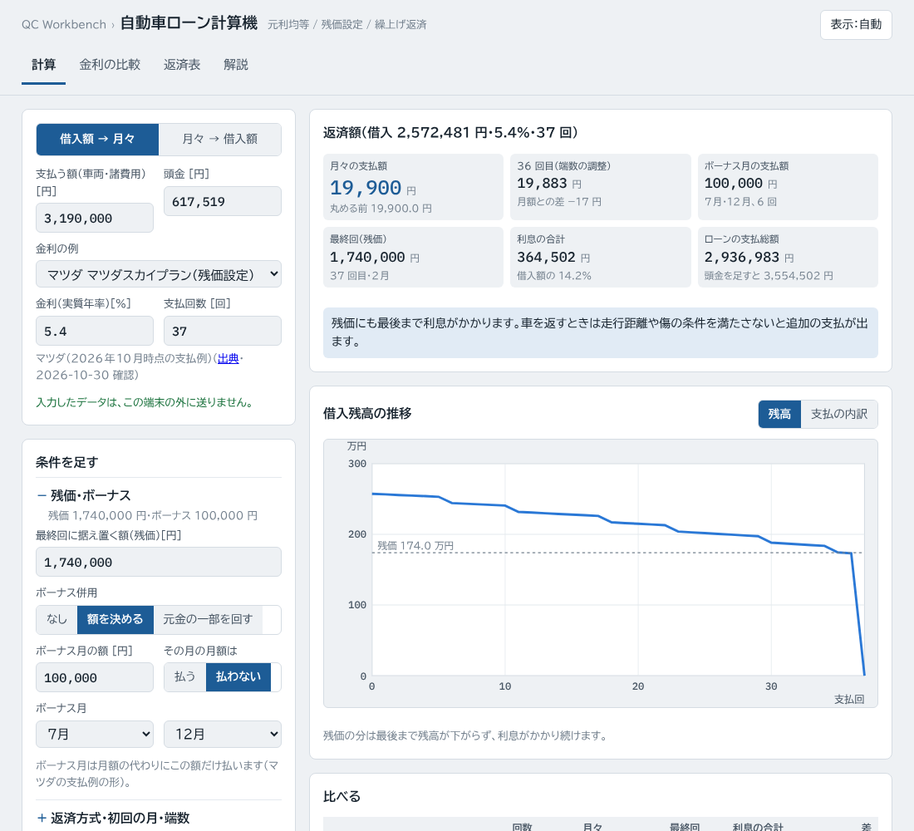
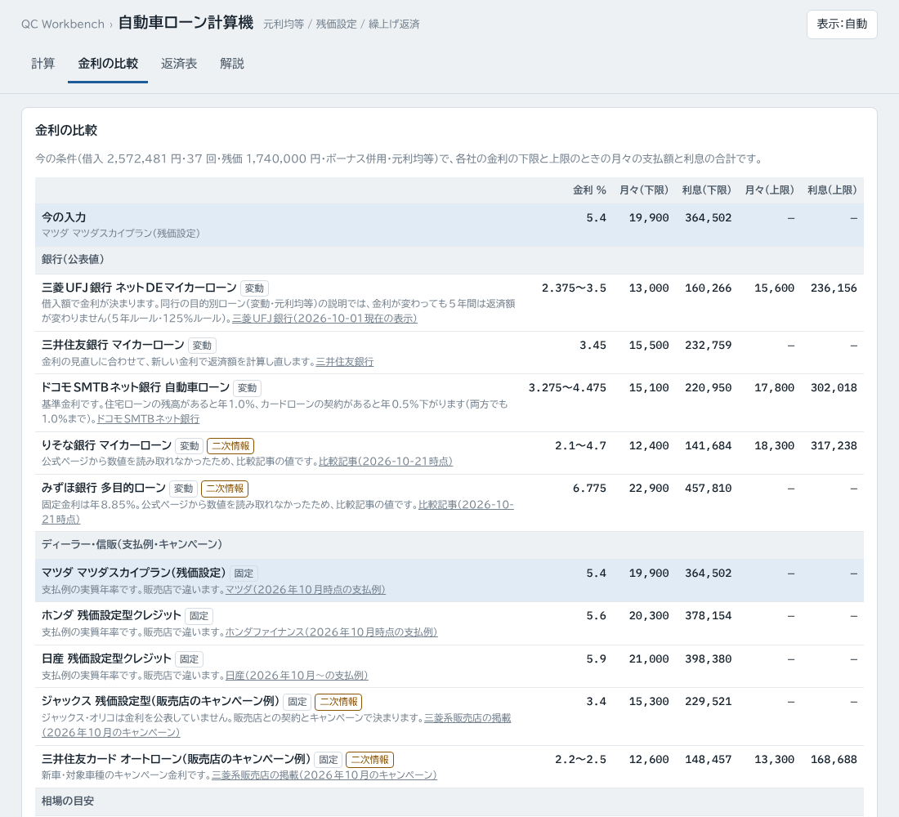
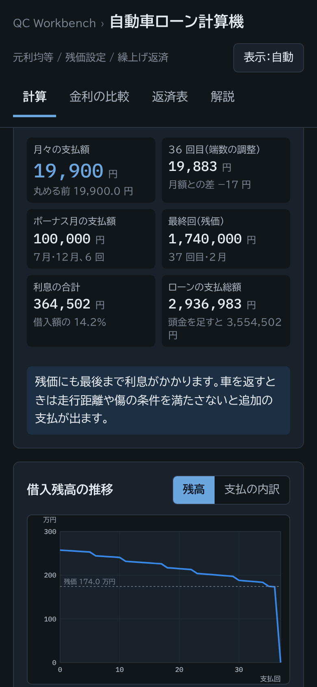

# 自動車ローン計算機（car-loan-calc）

借入額・金利（実質年率）・支払回数から、自動車ローンの**月々の支払額**と**利息の合計**を求める Web ツールです。ディーラーの残価設定ローン（据置）、ボーナス併用、月額の端数の扱い、繰上げ返済、変動金利の上昇を計算でき、銀行・ディーラーの金利の例と比べられます。

**https://kotaooka.github.io/car-loan-calc/**

インストールは不要で、ブラウザで開くだけで使えます。

- **入力したデータやファイルは、この端末の外に送りません**。計算はすべてブラウザの中で行います
- 画面の字体（BIZ UDPゴシック・IBM Plex Mono）は Google Fonts から読み込むため、開いたときに Google のサーバーへ接続します
- 一度開けば**オフラインでも動きます**。スマートフォンやPCにアプリとして追加することもできます。スマートフォンでは、基本の項目のすぐ下に月々の支払額（または借りられる額）を表示します

---

## できること

### 計算

最初に計算の向きを選び、基本の 4 項目を入れます。それ以外の条件は「条件を足す」で必要なものだけ開きます（閉じていても、見出しの下に今の設定が出ます）。

1. **計算の向き**：「借入額 → 月々」は支払う額（車両・諸費用）と頭金から月々を、「月々 → 借入額」は払える月々の額から借りられる額の上限を出します
2. **基本の項目**：頭金、金利（実質年率。「金利の例」から選ぶか見積書の金利を入れる）、支払回数
3. **条件を足す**
   - 残価・ボーナス：最終回に据え置く額と、ボーナス併用（ボーナス月の額を決める形＝ディーラー、元金の一部を回す形＝銀行）
   - 返済方式・初回の月・端数：元利均等・元金均等、初回の支払月、月額の単位（1・10・100・1,000 円未満を切捨て）と端数を払う回
   - 繰上げ返済：返す回と額。期間短縮と返済額軽減を比べます
   - 金利の変化：変わる回と変わったあとの金利（3 つまで）。返済額は「その都度計算し直す」か「5 年ルール」（125% ルールを含む）

| 出力 | 内容 |
|---|---|
| 月々 → 借入額 | 借りられる額の上限、頭金込みの支払う額の上限、回数（24〜120 回）を変えたときの上限。「借入額 → 月々」に切り替えてそのまま計算を続けられる |
| 返済額 | 月々の支払額、端数を払う回の額、ボーナス月の支払額、最終回（残価）、利息の合計（元金均等にしたときの差も）、支払総額 |
| 図 | 借入残高の推移（契約どおり・金利の変化・期間短縮・返済額軽減を重ねる）と、毎回の支払の内訳（元金と利息）を切り替え |
| 比べる | 残価・繰上げ返済・金利の変化を入れたときだけ表示。残価ありとなし、繰上げ返済のあり・なし、金利の変化のあり・なしの、回数・月々・最終回・利息の差 |
| 保存 | 結果を Excel 用にコピー |

### 金利の比較

今の条件（借入額・回数・残価・ボーナス）のまま、銀行・ディーラー・信販会社の金利の例の下限と上限で、月々の支払額と利息の合計を並べます。「月々 → 借入額」のときは、各金利で借りられる額を並べます。行を押すと、その金利で計算タブを開きます。

| 区分 | 載せているもの | 出典 |
|---|---|---|
| 銀行 | 三菱UFJ銀行、三井住友銀行、ドコモSMTBネット銀行（公式ページの表示）、りそな銀行、みずほ銀行（比較記事の値） | 各行の公式ページ、比較記事 |
| ディーラー | マツダ・ホンダ・日産の残価設定型クレジットの支払例の実質年率 | 各社の公式サイト（2026 年 10 月時点） |
| 信販会社 | ジャックス・三井住友カードの、販売店が掲載していたキャンペーン金利の例 | 販売店のページ |
| 相場の目安 | 信販系ディーラーローン、残価設定ローン、銀行マイカーローン | 解説記事 |

- 金利は **2026-10-30** に出典のページで確かめた値です。実際の金利は審査・借入日・申込方法・車種・時期で変わります
- **ジャックス・オリコなど信販会社は、オートローンの金利を公表していません**。販売店との契約とキャンペーンで決まるので、見積書の「実質年率」を入れてください
- 公式ページから数値を読み取れなかったものは、画面に「二次情報」と表示しています

### 返済表

毎回の支払額・元金・利息・残高（金利の変化があれば金利、5 年ルールで払いきれない利息があれば未払利息）を一覧にします。契約どおり・金利の変化・期間短縮・返済額軽減を切り替えられ、Excel 用にコピーできます。

---

## 計算の定義

- 月利 r = 実質年率 ÷ 12。毎回の利息は残高 × r の 1 円未満切捨て
- 元利均等の月額 A = P × r ÷ (1 − (1 + r)^−n)。月額は選んだ単位の未満を切り捨て、差は端数を払う回で調整
- 据置（残価 B）：1〜n−1 回に月額、n 回に B。A = (P − B ÷ (1 + r)^n) × r ÷ (1 − (1 + r)^−(n−1))
- 端数を払う回の額は、あとの支払で残高がちょうど 0（残価があるときは最終回がちょうど B）になるように、契約時の金利で逆算
- ボーナス（銀行の形）：ボーナス返済分を、ボーナス月だけで返す均等額にする。利息は前のボーナス月からの月数で月割り
- 元金均等：毎回の元金 = P ÷ n（単位未満は切捨て、差は最終回）、利息は残高 × r
- 繰上げ返済：指定した回の支払のあと、毎月分の元金に充てる。期間短縮は月額をそのままにして回数を減らし、返済額軽減は残りの回数で月額を出し直す
- 金利の変化：その都度計算し直す（変わった回から残りを均等額に）か、5 年ルール・125% ルール（60 回目までは同額、61 回目とその後の金利の変化のたびに出し直し、増額は前の 1.25 倍まで、払いきれない利息は繰り越して最終回にまとめて払う）

式の意味と例は、ツールの「解説」タブを見てください。

---

## 使うときの注意

- 初回の支払は借入の翌月とみなし、借入日から初回までの日割りの利息は計算しません。初回が 2 か月後になる契約では、実際の初回の額はこれより多くなります
- 事務手数料・所有権留保の手数料・繰上げ返済の手数料は入れていません。銀行の保証料は多くが金利に含まれています
- 銀行のボーナス返済は、初回ボーナスまでの月数が契約日で変わるため、ボーナス月の額が数 % 違うことがあります（下の「計算の検証」）
- 残価（据置）があるローンの一部繰上げ返済は、会社ごとに扱いが違うため計算しません。信販会社のローンは一部の繰上げ返済ができないことがあります
- 5 年ルールの区切りは 60 回で近似しています。三菱UFJ銀行は「10 月 1 日を 1 回経過するごとに 1 年」と数えます
- 元金だけを据え置いて利息だけを払う期間があるローン（三菱UFJ銀行の据置タイプなど）は計算できません。このツールの据置は、最終回に残価を払う形です
- 残価は、車を返すときの走行距離・傷の条件を満たさないと追加の支払が出ます
- 契約の判断は、販売店・銀行が出す返済予定表と見積書の数値で行ってください

---

## 計算の検証

`tests/test.js`（push のたびに GitHub Actions で実行）で次を確かめています。

- **元利均等・元金均等**：ドコモSMTBネット銀行の「元利均等返済と元金均等返済」の返済例（1,000 万円・年 3%・240 回）。元利均等の月額 55,459 円・総返済額 13,310,255 円は一致、元金均等の初回 66,666 円・120 回目 54,270 円は一致、総返済額 13,012,429 円とは最終回の元金の端数の寄せ方で 1 円違う
- **銀行のマイカーローン**：呉信用金庫の返済例。20 万円・1 年・2.00% の月額 16,847 円、借換え例（200 万円のうちボーナス分 60 万円・5 年）の毎月分 26,419 円（5.00%）・24,538 円（2.00%）は一致。借換え例のボーナス月の額は、初回ボーナスまでの月数が書かれていないため照合していません（初回を 6 か月後とした計算は公表値より 1.5% 少ない）
- **残価設定・ボーナス・端数**：各社の公式サイトの支払例（2026 年 10 月時点）6 例と照合
  - マツダスカイプラン 3 例（3 年・5 年・7 年）：月額・最終回 1 回前・分割支払金合計が 1 円まで一致
  - ホンダ 残価設定型クレジット（N-BOX・5 年）：月額は一致、初回は公表 16,138 円・計算 16,139 円（1 円差）
  - 日産 残価設定型クレジット（ノート 2 例）：月額は一致、最終回 1 回前は公表より 80 円・159 円少ない（0.35%・0.71%）。元金の表記（所要資金）が現金価格 − 頭金と合わないなど、前提が公表されていない部分があります。もう 1 例（ノート X FOUR）は月額の 100 円未満の決め方が違い（公表 19,400 円・計算 19,500 円）、照合から外しています
- **手計算できる代表点**：金利 0%、100 円単位の丸めと端数の調整、据置の月額の式、金利の変化（その都度計算・5 年ルールの据え置き・61 回目以降の出し直し・125% の上限・未払利息）、繰上げ返済（期間短縮で回数が減る、返済額軽減の新しい月額、金利変化と組み合わせたとき）、元金均等の初回
- **逆算**：結果の借入額で月額が目標以下、1 円増やすと目標を超えることを、元利均等・金利 0%・元金均等・マツダの支払例の条件・銀行のボーナス併用で往復して確認。3%・60 回の上限を手計算（月額 × 年金現価係数）と照合
- **入力の誤り**：借入額 0、回数 1、金利 30%、残価が借入額以上、ボーナス月が 1 つ、元金均等に残価、残価のあるローンの一部繰上げ
- **金利の例**：すべてに出典の URL があり、値が範囲内か

開発者向けの情報は [DEVELOPMENT.md](DEVELOPMENT.md) にあります。

## ライセンス

[MIT License](LICENSE)
